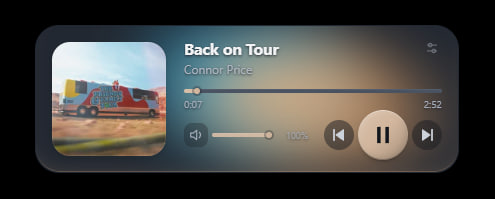

# PLIX

PLIX — компактный настольный мини-плеер для Яндекс Музыки в Windows.
Приложение создано на React, Vite, Tauri 2 и Rust и управляет воспроизведением через системную медиасессию Windows.



## Зачем создан PLIX

PLIX появился из-за отсутствия удобного режима
мини-плеера в настольной Яндекс Музыке.
Чтобы переключить трек, перемотать композицию
или изменить громкость, приходилось возвращаться
в основное окно приложения.

Я создал PLIX, чтобы основные элементы
управления музыкой всегда были под рукой.
Это компактный плеер для Windows, который
можно закрепить поверх других окон.

Со временем PLIX получил адаптивную
визуализацию, темы оформления и Hybrid Palette —
систему, которая подстраивает цвета интерфейса
под обложку и звучание музыки.

## Возможности

- Компактный мини-плеер для Windows.
- Управление воспроизведением Яндекс Музыки: воспроизведение, пауза, предыдущий и следующий трек.
- Обложка, название трека, прогресс воспроизведения и перемотка.
- Управление громкостью и отключение звука приложения Яндекс Музыки.
- Светлая и тёмная темы.
- Визуальные эффекты и реагирующая на звук визуализация на основе FFT.
- Hybrid Palette: цвета адаптируются к обложке и музыке.
- Интеграция с системным треем и контекстное меню.
- Always on top — закрепление поверх других окон.
- Сохранение настроек оформления.

Настольное приложение Яндекс Музыки должно быть запущено отдельно. Доступные команды
управления воспроизведением зависят от его активной медиасессии. Для захвата звука
для визуализации требуется поддержка process-loopback в Windows.

## Требования

- Windows 11 — основная целевая платформа.
- Настольное приложение Яндекс Музыки и Microsoft Edge WebView2 Runtime.
- Node.js 20.19+ или 22.12+ с npm, совместимый с Vite 7.
- Rust с набором инструментов MSVC, Visual Studio Build Tools с C++ и Windows SDK.

Все команды ниже выполняются из корня проекта.

## Установка / Запуск

```powershell
npm ci
npm run tauri -- dev
```

Для запуска фронтенда в браузере используйте `npm run dev`. Нативные медиакоманды
требуют запуска приложения через Tauri. Также можно использовать `start-dev.bat`,
который запускает приложение из каталога, содержащего BAT-файл.

## Проверка / Сборка

```powershell
npm run build
cargo check --manifest-path src-tauri/Cargo.toml --locked
```

Первая команда собирает фронтенд для выпуска в `dist/`; вторая проверяет
Rust-код. Эти команды не создают релизный EXE-файл. Для сборки релизного
исполняемого файла настольного приложения используйте Tauri CLI, который включает
production protocol и встраивает фронтенд:

```powershell
npm run tauri -- build --no-bundle --features tauri/custom-protocol
```

Для релизных сборок всегда используйте Tauri CLI. Обычный `cargo build --release`
не заменяет этот шаг; `src-tauri/build.rs` проверяет обязательное включение
production protocol.

## DEV-инструменты

`npm run dev:tuning` запускает плеер в режиме разработки и панель Visual Tuning
для настройки поверхностей, цветов и диагностики визуальных слоёв. Диагностические
режимы доступны в сборках для разработки.

Каталог `src/dev/` необходим целиком: его валидаторы также используются
DEV-мостом в конфигурации Vite. Алгоритмы палитры, используемые в релизной версии,
находятся в `src/palette/`, а код оформления — в `src/design/`. Сохранённые
настройки режима разработки хранятся в локальном хранилище браузера.

## Структура

- `src/` — интерфейс, оформление, визуализация и инструменты разработки.
- `src-tauri/` — интеграция с Windows, аудио, хранение настроек и ресурсы приложения.
- `scripts/` — запуск панели разработки, подготовка иконок и восстановление настроек по явной команде.
- `assets/branding/plix/` — исходные изображения и превью брендинга.
- `assets/readme/` — скриншоты для этого README.
- [Контекстное меню](CONTEXT-MENU.md) — поведение и управление с клавиатуры.

Зависимости зафиксированы в `package-lock.json` и `src-tauri/Cargo.lock`.
Прежние конфигурационные идентификаторы Ympleer сохранены для совместимости
настроек и интеграции с Windows. Исторические тестовые наборы, прототипы, локальные
данные и результаты сборки исключены из этого публичного репозитория.

## Сторонний код

- Lucide: [лицензия ISC](src/context_menu/context-menu-icons/LICENSE).
- Локальная адаптация плагина Tauri single-instance для Windows:
  [лицензия MIT](src-tauri/vendor/tauri-plugin-single-instance/LICENSE-MIT)
  и [сведения об исходном проекте](src-tauri/vendor/tauri-plugin-single-instance/UPSTREAM.md).
- Зависимости npm и Cargo сохраняют собственные лицензии.
