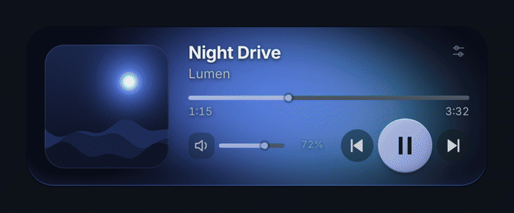
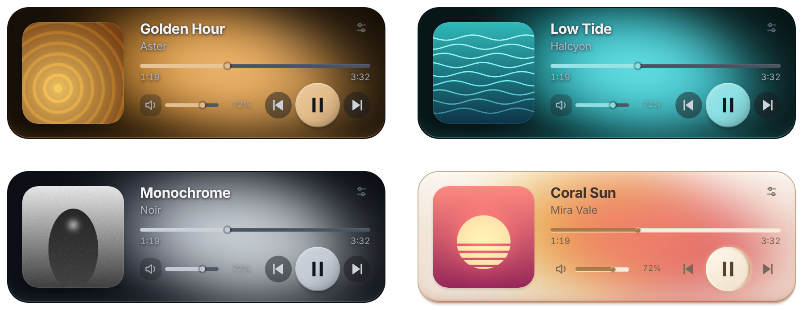

<p align="center">
  
</p>

<h1 align="center">PLIX</h1>

<p align="center">
  Компактный мини-плеер для Яндекс Музыки в Windows.<br>
  Всегда под рукой, поверх любых окон, с визуализацией, которая живёт вместе с музыкой.
</p>

<p align="center">
  <a href="https://github.com/karlenlabs/PLIX/releases/latest"></a>
  <a href="https://github.com/karlenlabs/PLIX/releases"></a>
  
</p>

<p align="center">
  <a href="https://github.com/karlenlabs/PLIX/releases/latest"><b>⬇ Скачать PLIX для Windows</b></a>
</p>

---

## Как это выглядит

<p align="center">
  
</p>

Цвета визуализации и фон плеера подстраиваются под обложку каждого трека.
Чёрно-белые обложки получают чистое светлое свечение. Справа внизу — светлая тема.

## Возможности

**Управление музыкой**
- Воспроизведение, пауза, предыдущий и следующий трек, перемотка.
- Обложка, название и исполнитель, прогресс трека.
- Громкость и отключение звука Яндекс Музыки прямо из плеера.

**Оформление**
- Три стиля визуализации — Flow, Pulse и Flux — реагируют на звук в реальном времени.
- Hybrid Palette: цвета подбираются по обложке и музыке. Чёрно-белые обложки
  получают чистое светлое свечение без выдуманных оттенков.
- Фон плеера на выбор: классический, под обложку или глубокий тёмно-бирюзовый.
- Тёмная и светлая темы, мягкая дымка Ambient Haze.

**Удобство**
- Закрепление поверх всех окон.
- Значок в трее и контекстное меню.
- Все настройки сохраняются между запусками.

## Как начать пользоваться

1. Скачайте `PLIX.exe` из [последнего релиза](https://github.com/karlenlabs/PLIX/releases/latest). Установка не нужна.
2. Запустите настольное приложение Яндекс Музыки и включите любой трек.
3. Запустите `PLIX.exe`. Настройки оформления открываются кнопкой в правом
   верхнем углу плеера или через контекстное меню (правый клик по плееру).

Сборка не подписана, поэтому Windows может показать предупреждение при первом запуске.

**Нужно:** Windows 11 (x64), настольное приложение Яндекс Музыки и Microsoft Edge
WebView2 Runtime (в Windows 11 обычно уже установлен). PLIX не воспроизводит музыку
сам — он управляет медиасессией Яндекс Музыки. Для визуализации нужна поддержка
process-loopback в Windows.

## Зачем создан PLIX

В настольной Яндекс Музыке нет удобного мини-плеера. Чтобы переключить трек,
перемотать композицию или изменить громкость, приходилось каждый раз
возвращаться в основное окно приложения.

Я создал PLIX, чтобы основное управление музыкой всегда было под рукой — в компактном
окне, которое можно закрепить поверх остальных. Со временем у него появились
визуализация, темы оформления и Hybrid Palette — система, которая подстраивает
цвета интерфейса под обложку и звучание музыки.

## Для разработчиков

<details>
<summary>Сборка, запуск из исходников и DEV-инструменты</summary>

PLIX написан на React, Vite, Tauri 2 и Rust и управляет воспроизведением через
системную медиасессию Windows.

### Требования

- Node.js 20.19+ или 22.12+ с npm, совместимый с Vite 7.
- Rust с набором инструментов MSVC, Visual Studio Build Tools с C++ и Windows SDK.

Все команды ниже выполняются из корня проекта.

### Запуск из исходников

```powershell
npm ci
npm run tauri -- dev
```

Для запуска фронтенда в браузере используйте `npm run dev`. Нативные медиакоманды
требуют запуска приложения через Tauri. Также можно использовать `start-dev.bat`,
который запускает приложение из каталога, содержащего BAT-файл.

### Проверка и сборка

```powershell
npm run typecheck
npm run build
cargo check --manifest-path src-tauri/Cargo.toml --locked
```

Эти команды проверяют код и собирают фронтенд в `dist/`, но не создают релизный
EXE-файл. Релизный исполняемый файл собирается через Tauri CLI, который включает
production protocol и встраивает фронтенд:

```powershell
npm run tauri -- build --no-bundle --features tauri/custom-protocol
```

Обычный `cargo build --release` не заменяет этот шаг: `src-tauri/build.rs` проверяет
обязательное включение production protocol.

### DEV-инструменты

`npm run dev:tuning` запускает плеер в режиме разработки и панель Visual Tuning
для настройки поверхностей, цветов, прозрачности и яркости блобов, а также для
диагностики визуальных слоёв.

Сборка для разработки может работать одновременно с установленной релизной версией:
защита от второго экземпляра действует только в релизе, а у DEV-версии отдельный
профиль WebView2. Настройки оформления у обеих версий общие.

Каталог `src/dev/` необходим целиком: его валидаторы также используются DEV-мостом
в конфигурации Vite. Экспериментальные DEV-функции описаны в [`docs/dev-notes/`](docs/dev-notes/).

### Структура

- `src/` — интерфейс, визуализация и инструменты разработки; алгоритмы палитры —
  в `src/palette/`, оформление — в `src/design/`.
- `src-tauri/` — интеграция с Windows, аудио, хранение настроек и ресурсы приложения.
- `scripts/` — запуск панели разработки, подготовка иконок, тесты и восстановление настроек.
- `docs/dev-notes/` — заметки к экспериментальным DEV-функциям.
- `assets/branding/plix/` — исходные изображения и превью брендинга.
- `assets/readme/` — изображения для этого README.
- [Контекстное меню](CONTEXT-MENU.md) — поведение и управление с клавиатуры.

Зависимости зафиксированы в `package-lock.json` и `src-tauri/Cargo.lock`.
Прежние конфигурационные идентификаторы Ympleer сохранены для совместимости
настроек и интеграции с Windows.

</details>

## Сторонний код

- Lucide: [лицензия ISC](src/context_menu/context-menu-icons/LICENSE).
- Локальная адаптация плагина Tauri single-instance для Windows:
  [лицензия MIT](src-tauri/vendor/tauri-plugin-single-instance/LICENSE-MIT)
  и [сведения об исходном проекте](src-tauri/vendor/tauri-plugin-single-instance/UPSTREAM.md).
- Зависимости npm и Cargo сохраняют собственные лицензии.

---

<details>
<summary><b>English</b></summary>

**PLIX** is a compact mini-player for the Yandex Music desktop app on Windows 11.
It stays on top of other windows and gives you playback controls, artwork, seeking
and volume, with music-reactive visualizations whose colors — and the player
background — adapt to each track's artwork.

[Download the latest release](https://github.com/karlenlabs/PLIX/releases/latest) —
no installer needed. Requires Windows 11 (x64), the Yandex Music desktop app and
Microsoft Edge WebView2 Runtime. PLIX does not play music itself; it controls the
active Yandex Music media session. The build is unsigned, so Windows may show a
warning on first launch.

</details>
